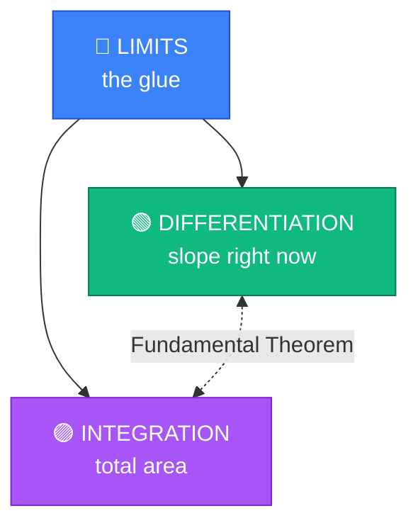
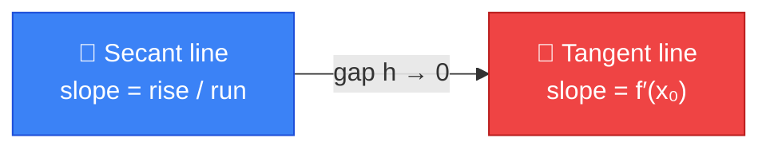

<div align="center">


</div>

```text
root@gate:~$ ./calculus --mode=exam --speed=max
[ OK ] limits ........... loaded
[ OK ] derivatives ...... loaded
[ OK ] integrals ........ loaded
>> ready. grab a notebook.
```

> **Nobody is "dumb" at calculus** — people just get handed dry formulas before anyone shows them the movie playing underneath.

Strip away the intimidating Greek symbols, and the entire subject is built on **two superpowers, held together by one glue**:

| | Idea | In one line |
|:--|:--|:--|
| 🔵 **The Glue** | **Limits** | Getting infinitely close to a number without ever touching it. |
| 🟢 **Superpower 1** | **Differentiation** | Zooming in on a curved line until it looks completely straight, just to measure its exact slope *right now*. |
| 🟣 **Superpower 2** | **Integration** | Slicing a weird curved shape into infinitely thin rectangles and gluing their areas back together. |



> [!IMPORTANT]
> Master those three ideas, and you own the entire **GATE Calculus** syllabus.

## 🧭 Table of Contents

| # | Module | Jump |
|:-:|:--|:-:|
| 🔵 1 | Limits — The "Neighborhood Gossip" Rule | [→](#module-1) |
| 🟢 2 | Continuity & Differentiability — The Smoothness Ladder | [→](#module-2) |
| 🟡 3 | Mean Value Theorems — The "Speeding Ticket" Theorems | [→](#module-3) |
| 🟠 4 | Maxima, Minima & Curve Anatomy | [→](#module-4) |
| 🟣 5 | Integration — Gluing Infinite Slices Back Together | [→](#module-5) |
| 🔴 6 | GATE Boss-Level Solved Mini-Arena | [→](#module-6) |

---

<a id="module-1"></a>
## 🔵 Module 1: Limits — The "Neighborhood Gossip" Rule

A limit $\lim_{x \to a} f(x) = L$ asks one simple question:

> *"As $x$ creeps infinitely close to $a$ from both sides, what height $L$ does the graph seem to be aiming at?"*

> [!NOTE]
> **The Golden Rule of Limits:** a limit is pure neighborhood gossip. It does **not** care what happens *at* $x = a$ (there could be a hole there, or the function could jump to Pluto). It only cares what happens immediately to the **left (LHL)** and immediately to the **right (RHL)**.

A limit exists **if and only if**:

$$\text{LHL} = \lim_{x \to a^-} f(x) \;=\; \text{RHL} = \lim_{x \to a^+} f(x) \;=\; \text{a single finite number } L$$

### 🎭 The 7 Indeterminate Forms & GATE Escape Hatches

If you plug in $x = a$ and get a clean number like $\frac{5}{2}$ or $0$, **stop — you're done!** Trouble only starts when you hit one of the 7 indeterminate forms (tug-of-wars where two forces fight and you don't know who wins yet):

| Indeterminate Form | What's Fighting? | 🚪 GATE Escape Hatch |
|:--|:--|:--|
| $\frac{0}{0}$ or $\frac{\infty}{\infty}$ | Numerator vs. Denominator | **L'Hôpital's Rule** (differentiate top & bottom separately) or **Taylor Series** |
| $0 \cdot \infty$ | Shrinking factor vs. Exploding factor | Flip one to the denominator: $f \cdot g = \dfrac{f}{1/g}$ → becomes $\frac{0}{0}$ or $\frac{\infty}{\infty}$ |
| $\infty - \infty$ | Two infinities subtracting | Take LCM, factor out the highest power, or rationalize ($\sqrt{a}-\sqrt{b}$) |
| $1^\infty$ | Base near $1$ vs. Infinite exponent | ⚡ **Speed Formula:** $\lim f(x)^{g(x)} = e^{\lim g(x)\cdot(f(x) - 1)}$ |
| $0^0$ or $\infty^0$ | Base vs. Zero exponent | Let $y = f(x)^{g(x)} \Rightarrow \ln y = g(x)\ln f(x)$, solve the $0 \cdot \infty$ limit, then raise $e^{\text{answer}}$ |

> [!CAUTION]
> **GATE Trap Alert:** Never blindly apply L'Hôpital's Rule! Verify it is *strictly* $\frac{0}{0}$ or $\frac{\infty}{\infty}$ at **every single step**. Differentiating a non-indeterminate fraction like $\frac{2}{0}$ gives total nonsense.

### ☢️ The Nuclear Weapon: Maclaurin Series Cheat Sheet

When GATE gives you a messy limit as $x \to 0$ with $x^4$ or $x^5$ in the denominator, L'Hôpital's Rule will waste **4 minutes** of your exam. Memorize these 5 expansions and crush those limits in **15 seconds**:

| 🧪 Function | Expansion | 🧠 Memory Hook |
|:--|:--|:--|
| $e^x$ | $1 + x + \dfrac{x^2}{2!} + \dfrac{x^3}{3!} + \dots$ | every power, all plus signs |
| $\sin x$ | $x - \dfrac{x^3}{3!} + \dfrac{x^5}{5!} - \dots$ | **odd** powers, alternating signs |
| $\cos x$ | $1 - \dfrac{x^2}{2!} + \dfrac{x^4}{4!} - \dots$ | **even** powers, alternating signs |
| $\ln(1+x)$ | $x - \dfrac{x^2}{2} + \dfrac{x^3}{3} - \dfrac{x^4}{4} + \dots$ | **no factorials!** |
| $(1+x)^n$ | $1 + nx + \dfrac{n(n-1)}{2!}x^2 + \dots$ | binomial series |

#### 🎁 Bonus Standard Limits (keep on speed dial)

$$
\lim_{x \to 0}\frac{\sin x}{x} = 1 \qquad
\lim_{x \to 0}\frac{\tan x}{x} = 1 \qquad
\lim_{x \to 0}\frac{e^x - 1}{x} = 1
$$

$$
\lim_{x \to 0}\frac{\ln(1+x)}{x} = 1 \qquad
\lim_{x \to \infty}\left(1 + \frac{k}{x}\right)^x = e^k
$$

### 🥪 Sandwich (Squeeze) Theorem

If $g(x) \le f(x) \le h(x)$ near $a$, and both the floor $g(x)$ and ceiling $h(x)$ converge to $L$, then $f(x)$ is trapped and **must** converge to $L$.

> [!TIP]
> **Classic GATE cue:** anything multiplied by $\sin(1/x)$ or $\cos(1/x)$ (which oscillate violently between $-1$ and $1$).

---

<a id="module-2"></a>
## 🟢 Module 2: Continuity & Differentiability — The Smoothness Ladder

Think of a graph as a **rollercoaster track**.

- 🟢 **Continuous at $x = a$:** you can draw the track through $x = a$ without lifting your pen. No holes, no jumps, no vertical cliffs.

$$\text{LHL} = \text{RHL} = f(a)$$

- 🔵 **Differentiable at $x = a$:** the track is not just connected — it is **smooth**. No sharp V-corners (where your neck would snap) and no vertical tangent lines (infinite slope).


> [!WARNING]
> Going **backwards** is NEVER guaranteed!

### 📐 How a Derivative Is Actually Born

To find the exact slope of $y = f(x)$ at a single point $P = (x_0, f(x_0))$, pick a second point $(x, f(x))$ further along the curve and draw the **secant line** connecting them. Its slope is simply rise over run:

$$\frac{f(x) - f(x_0)}{x - x_0}$$

As the horizontal gap $x - x_0$ shrinks to zero, the secant line pivots seamlessly into the **tangent line** grazing $P$:



That limiting slope **is** the derivative:

$$f'(x_0) = \lim_{x \to x_0} \frac{f(x) - f(x_0)}{x - x_0} = \lim_{h \to 0} \frac{f(x_0 + h) - f(x_0)}{h}$$

> [!NOTE]
> For $f'(x_0)$ to exist, the **Left-Hand Derivative (LHD)** must equal the **Right-Hand Derivative (RHD)** and be finite.

### 🏆 The 5 Hall-of-Fame GATE Test Functions (at $x = 0$)

GATE examiners adore building True/False and MSQ questions around these exact functions:

| Function $f(x)$ | Continuous at $x=0$? | Differentiable at $x=0$? | 👁️ Visual Intuition |
|:--|:-:|:-:|:--|
| $\lvert x \rvert$ | ✅ Yes | ❌ No | Sharp V-corner: $\text{LHD} = -1$, $\text{RHD} = +1$ |
| $x\lvert x \rvert$ | ✅ Yes | ✅ Yes ($f'(0)=0$) | Smooth S-bend, though $f''(0)$ does **not** exist! |
| $x^{1/3}$ | ✅ Yes | ❌ No | Smooth curve, but goes completely vertical ($f'(0) = \infty$) |
| $x \sin(1/x)$ *(with $f(0)=0$)* | ✅ Yes | ❌ No | Pinched to $0$, but wiggles too violently to have one slope |
| $x^2 \sin(1/x)$ *(with $f(0)=0$)* | ✅ Yes | ✅ Yes ($f'(0)=0$) | $x^2$ crushes the wiggle flat enough to make slope $0$ |

---

<a id="module-3"></a>
## 🟡 Module 3: Mean Value Theorems — The "Speeding Ticket" Theorems

> 🚗 Imagine you drive **120 km** down a highway in **2 hours**. Your average speed is 60 km/h. Even if you sped up and slowed down, could you possibly finish the trip without your speedometer hitting exactly 60 km/h at least once?

**No!** As long as your motion had no teleportation (*continuous on $[a,b]$*) and no instant velocity jumps (*differentiable on $(a,b)$*), there must be at least one instant $c \in (a,b)$ where your instantaneous speed equals your average speed.

| 📜 Theorem | ✔️ Required Conditions | 🎯 Guarantee (for some $c \in (a,b)$) | 📐 Geometric Meaning & GATE Use |
|:--|:--|:--|:--|
| 🔴 **Rolle's Theorem** | 1. Continuous on $[a,b]$<br>2. Differentiable on $(a,b)$<br>3. $f(a) = f(b)$ | $f'(c) = 0$ | Flat horizontal tangent between two equal heights.<br>**GATE use:** between any two real roots of $f(x)$, there is at least one root of $f'(x)$. |
| 🟡 **Lagrange's MVT (LMVT)** | 1. Continuous on $[a,b]$<br>2. Differentiable on $(a,b)$ | $f'(c) = \dfrac{f(b) - f(a)}{b - a}$ | At least one tangent line is parallel to the secant chord joining $a$ and $b$.<br>**GATE use:** bounding $f(b)$ given bounds on $f'(x)$ (e.g., if $f'(x) \le 3$, then $f(5)-f(2) \le 9$). |
| 🟣 **Cauchy's MVT (CMVT)** | $f, g$ continuous on $[a,b]$, differentiable on $(a,b)$, and $g'(x) \neq 0$ | $\dfrac{f'(c)}{g'(c)} = \dfrac{f(b) - f(a)}{g(b) - g(a)}$ | Generalized LMVT for two functions; this is the theorem that **proves L'Hôpital's Rule**! |

> [!WARNING]
> **Watch the brackets!** Continuity is required on the **closed** interval $[a, b]$, while differentiability is only needed on the **open** interval $(a, b)$. If there is even one sharp corner strictly inside $(a, b)$ (like $\lvert x \rvert$ on $[-1, 1]$), Rolle's and LMVT immediately fail!

---

<a id="module-4"></a>
## 🟠 Module 4: Maxima, Minima & Curve Anatomy

Finding the highest peak or lowest valley of a function is one of the **highest-yield GATE topics**. Don't just memorize formulas — picture a hiker walking along the curve from left to right:

| 🥾 Term | Condition | Picture |
|:--|:--|:--|
| 🟢 **Increasing** | $f'(x) > 0$ | walking uphill |
| 🔴 **Decreasing** | $f'(x) < 0$ | walking downhill |
| 😀 **Concave Up** ($\cup$) | $f''(x) > 0$ | slope is getting steeper |
| 🙁 **Concave Down** ($\cap$) | $f''(x) < 0$ | slope is flattening / dropping |

### 🗺️ Step-by-Step Extrema Protocol

**Step 1 — Hunt ALL critical points.** Find every $x = c$ where $f'(c) = 0$ **OR** $f'(c)$ is undefined (never forget sharp corners like $\lvert x-2 \rvert$!).

**Step 2 — Classify local extrema (Second Derivative Test):**

| $f''(c)$ | Verdict |
|:-:|:--|
| $< 0$ &nbsp;(frowny face $\cap$) | 🔺 **Local Maximum** |
| $> 0$ &nbsp;(smiley face $\cup$) | 🔻 **Local Minimum** |
| $= 0$ | ⚠️ **Test fails!** Do NOT call it an inflection point yet! |

**Step 3 — The Higher-Order Derivative Tie-Breaker** (when $f''(c) = 0$): keep differentiating until you hit the first non-zero derivative $f^{(n)}(c) \neq 0$:

| $n$ is… | Example | Verdict |
|:-:|:--|:--|
| 🟣 **ODD** | $f(x) = x^3$ at $0$, where $f'''(0) = 6 \neq 0$ | **Point of Inflection** (neither max nor min) |
| 🟢 **EVEN** | $f(x) = x^4$ at $0$, where $f^{(4)}(0) = 24 > 0$ | **Local Minimum** if $f^{(n)}(c) > 0$, **Local Maximum** if $f^{(n)}(c) < 0$ |

### 🌍 Global (Absolute) Extrema on a Closed Interval $[a, b]$

> [!IMPORTANT]
> A local peak might still be shorter than the cliff at the boundary! Always build a candidate list containing **all critical points inside $(a, b)$ PLUS both endpoints $a$ and $b$**, evaluate $f(x)$ at every single one, and simply pick the largest and smallest values.

---

<a id="module-5"></a>
## 🟣 Module 5: Integration — Gluing Infinite Slices Back Together

Differentiation breaks a motion down into instantaneous speeds. **Integration runs the movie in reverse:** given the speed at every instant, it sums up the tiny slices $f(x)\,dx$ to recover the total **signed net area** (area above the $x$-axis is positive; area below is negative).

### 🛠️ The Fundamental Theorem of Calculus & The Leibniz Power Tool

**FTC (Evaluation):** if $F'(x) = f(x)$, then

$$\int_a^b f(x)\,dx = F(b) - F(a)$$

**Newton–Leibniz Rule** (differentiating an integral with variable limits):

$$\frac{d}{dx} \left( \int_{g(x)}^{h(x)} f(t)\,dt \right) = f(h(x)) \cdot h'(x) \;-\; f(g(x)) \cdot g'(x)$$

> [!TIP]
> If a GATE question asks for the derivative of an integral (or drops an integral inside a $\frac{0}{0}$ L'Hôpital limit), **do not waste time integrating!** Differentiate the boundary directly.

### ⚡ The 5 Definite Integral Shortcuts That Save Minutes

#### 👑 1. King's Property

$$\int_a^b f(x)\,dx = \int_a^b f(a + b - x)\,dx$$

🔥 **Fire it when:** $f(x) + f(a+b-x)$ simplifies magically — add the original $I$ and the transformed $I$ to get $2I$.

#### 🪞 2. Even / Odd Symmetry

$$
\int_{-a}^{a} f(x)\,dx =
\begin{cases}
0 & \text{if } f(-x) = -f(x) \text{ (odd)} \\
2\displaystyle\int_0^a f(x)\,dx & \text{if } f(-x) = f(x) \text{ (even)}
\end{cases}
$$

🔥 **Fire it when:** first check on **any symmetric interval** $[-a, a]$! Kills ugly odd terms instantly.

#### 👸 3. Queen's Property

$$
\int_0^{2a} f(x)\,dx =
\begin{cases}
2\displaystyle\int_0^a f(x)\,dx & \text{if } f(2a-x) = f(x) \\
0 & \text{if } f(2a-x) = -f(x)
\end{cases}
$$

🔥 **Fire it when:** integrals from $0$ to $\pi$ or $0$ to $2\pi$ involving $\sin x, \cos x$.

#### 🌀 4. Wallis' Formula

$$\int_0^{\pi/2} \sin^m x \cos^n x \, dx = \frac{[(m-1)(m-3)\dots][(n-1)(n-3)\dots]}{(m+n)(m+n-2)\dots} \cdot K$$

🔥 $K = \frac{\pi}{2}$ **only if both $m, n$ are even**; otherwise $K = 1$.

#### ➕ 5. Limit of a Sum

$$\lim_{n \to \infty} \frac{1}{n} \sum_{r=1}^{n} f\left(\frac{r}{n}\right) = \int_0^1 f(x)\,dx$$

🔥 **Fire it when:** replace $\frac{r}{n} \to x$, $\frac{1}{n} \to dx$, and find limits as $n \to \infty$ for the lower and upper summation bounds.

### ♾️ Improper Integrals & The $p$-Test

What if an integral stretches to $\infty$, or hits a vertical asymptote (division by zero) inside the interval? That's an **improper integral** — it **converges** if the area settles to a finite number, and **diverges** if the area blows up to $\infty$.

Two landmark $p$-tests rule them all:

| 🔭 Type | Integral | ✅ Converges iff | 💡 Why |
|:--|:--|:-:|:--|
| **Infinite Tail** | $\displaystyle\int_1^\infty \frac{1}{x^p}\,dx$ | $p > 1$ | needs to decay fast enough to starve the infinite tail |
| **Vertical Asymptote at Zero** | $\displaystyle\int_0^1 \frac{1}{x^p}\,dx$ | $p < 1$ | the spike near $0$ must stay skinny enough |

> [!NOTE]
> Notice $p = 1$, i.e. $\frac{1}{x}$, **diverges in both cases** because $\ln x$ blows up at both $\infty$ and $0$!

---

<a id="module-6"></a>
## 🔴 Module 6: GATE Boss-Level Solved Mini-Arena

Watch how clean these look when you use the **right weapon** instead of brute force. *(Try each one yourself first, then open the solution.)*

### 👾 Boss 1: The Taylor Series Limit Crusher

**Problem:** Evaluate $\displaystyle\lim_{x \to 0} \frac{\sin x - x + \frac{x^3}{6}}{x^5}$.

```diff
- Naive way: apply L'Hôpital's Rule 5 times and pray you don't drop a minus sign.
+ Mathematician's way: substitute the Maclaurin series of sin x.
```

<details>
<summary><b>🔓 Reveal solution</b></summary>

Plug in $\sin x = x - \frac{x^3}{3!} + \frac{x^5}{5!} - \dots = x - \frac{x^3}{6} + \frac{x^5}{120} - \dots$:

$$\lim_{x \to 0} \frac{\left(x - \frac{x^3}{6} + \frac{x^5}{120} - \dots\right) - x + \frac{x^3}{6}}{x^5} = \lim_{x \to 0} \frac{\frac{x^5}{120} - O(x^7)}{x^5} = \mathbf{\frac{1}{120}}$$

</details>

### 👾 Boss 2: The Iconic Leibniz + L'Hôpital Combo

**Problem:** Evaluate $\displaystyle\lim_{x \to 0} \frac{\int_0^{x^2} \cos(t^2)\,dt}{x^2}$.

<details>
<summary><b>🔓 Reveal solution</b></summary>

**Check the form at $x = 0$:** numerator is $\int_0^0 \cos(t^2)\,dt = 0$; denominator is $0$. Valid $\frac{0}{0}$ form! ✅

**Apply L'Hôpital + Leibniz Rule:**

- Derivative of numerator: $\cos\left((x^2)^2\right) \cdot \frac{d}{dx}(x^2) - 0 = 2x\cos(x^4)$
- Derivative of denominator: $2x$

**Evaluate:**

$$\lim_{x \to 0} \frac{2x\cos(x^4)}{2x} = \lim_{x \to 0} \cos(x^4) = \cos(0) = \mathbf{1}$$

</details>

### 👾 Boss 3: The Sneaky Endpoint Trap

**Problem:** Find the global maximum and global minimum of $f(x) = x^3 - 3x + 1$ on $[-2, 3]$.

<details>
<summary><b>🔓 Reveal solution</b></summary>

**Critical points:** $f'(x) = 3x^2 - 3 = 3(x-1)(x+1) = 0 \Rightarrow x = -1$ and $x = 1$ (both lie inside $[-2, 3]$).

**Test critical points AND endpoints:**

| $x$ | $f(x)$ | Note |
|:-:|:-:|:--|
| $-2$ | $\mathbf{-1}$ | endpoint |
| $-1$ | $3$ | only a local max! |
| $1$ | $\mathbf{-1}$ | local min, tied for global min |
| $3$ | $\mathbf{19}$ | endpoint — crushes the local max! |

**Verdict:**

- 🔺 **Global Max** $= 19$ (at $x = 3$)
- 🔻 **Global Min** $= -1$ (at $x = -2$ and $x = 1$)

</details>

---

<div align="center">

```text
>> all modules complete. go crush GATE.
```


</div>
